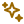

<h1 align="center">Hi, I'm Qizhen Lan</h1>

  Postdoctoral Research Fellow at <a href="https://www.uth.edu/">UTHealth Houston</a>

  <a href="https://lanqz7766.github.io/"> Website</a> ·
  <a href="https://scholar.google.com/citations?user=hz8cb2AAAAAJ&hl=en&oi=ao"> Google Scholar</a> ·
  <a href="https://lanqz7766.github.io/assets/files/curriculum_vitae.pdf"> CV</a> ·
  <a href="https://www.linkedin.com/in/qizhen-lan/"> LinkedIn</a> ·
  <a href="mailto:Qizhen.Lan@uth.tmc.edu"> Email</a>

I build AI systems at the intersection of visual intelligence, efficient learning, and agentic workflows. My work spans computer vision, medical imaging, model compression, multimodal reasoning, and reliable AI systems, with a practical focus on methods that hold up beyond curated benchmarks.

I am currently exploring workflow-facing AI, including clinical agents, deployable medical AI, trustworthy evaluation, and efficient models under real resource constraints.

## Recent repositories (not a publication list)

 Selected codebases, datasets, and recent paper highlights.

 **[NeurIPS 2026 E&D, Poster]** [BrainTRACE](https://github.com/lanqz7766/BrainTRACE): A benchmark for longitudinal, multimodal, and volumetric reasoning over brain MRI (co-first author). 

 **[NeurIPS 2026 E&D, Poster]** [OpenBrain](https://huggingface.co/datasets/lanqz7766/OpenBrain): An auditable whole-brain MRI parcellation dataset with 35,838 cases, generated labels, provenance, and quality-control metadata (first author). 

 **[NeurIPS 2026, Poster]** [ValuSpec](https://neurips.cc/virtual/2026/loc/sydney/poster/154357): Plug-and-play candidate valuation before target verification for tree-based speculative decoding. 

 **[MICCAI 2026]** [DCD-3D-MedSeg](https://github.com/ClinicaAlpha/DCD-3D-MedSeg): Detail-consistent stage-wise distillation for efficient 3D MRI segmentation (last and corresponding author). 

 **[MICCAI 2026]** [DPRD-3D-MedSeg](https://github.com/ClinicaAlpha/DPRD-3D-MedSeg): Displacement-preserving relational distillation for robust medical segmentation (last and corresponding author). 

 **[ICLR 2026]** [Uni-NTFM](https://github.com/czs-ict/Uni-NTFM): A unified foundation model for EEG signal representation learning. 

 **[WWW 2026]** [DAAO](https://github.com/AutoAgents-ai/DAAO): Difficulty-aware agentic orchestration for query-specific multi-agent workflows. 

 **[ACL 2026 Main, Oral]** [KnowMeBench](https://github.com/QuantaAlpha/KnowMeBench): A benchmark for understanding people in lifelong digital companions. 

 **[ECCV 2026]** [VIGIL](https://xixiaouab.github.io/VIGIL/): Counterfactual visual alignment for reducing visual laziness in MLLMs. 

 **[WACV 2024]** [GKD](https://github.com/lanqz7766/GKD): Gradient-guided knowledge distillation for object detectors. 

## Recent updates

- [2026] Three papers accepted to [WACV 2027](https://wacv.thecvf.com/): *MedSTP*, *Do Medical VLMs Look at the Lesion?*, and *The Scope of Not*.
- [2026] Three papers accepted to NeurIPS 2026: [BrainTRACE](https://github.com/lanqz7766/BrainTRACE) and [OpenBrain](https://huggingface.co/datasets/lanqz7766/OpenBrain) in the Evaluations & Datasets Track, and [ValuSpec](https://neurips.cc/virtual/2026/loc/sydney/poster/154357). All three are Posters.
- [2027] Co-organizing the [1st Latent Visual Reasoning (LVR) Workshop](https://chenliu-1996.github.io/LVR-WACV2027/) at WACV 2027. See you in Orlando!
- [2026] *Time Matters* was nominated and shortlisted for the MICCAI 2026 Best Paper and Young Scientist Award.
- [2026] Two papers accepted to EMNLP 2026: [ComfySearch](https://arxiv.org/pdf/2601.04060) in Findings (co-first author) and KnowMeBenchV2 in the Main Conference (Oral).
- [2026] Three papers accepted to MICCAI, with one Oral and one Spotlight presentation; last and corresponding author on DCD and DPRD.
- [2026] KnowMeBench accepted to ACL Main as an Oral Presentation.
- [2026] VIGIL accepted to ECCV.
- [2026] One paper accepted to *Neural Networks*.

## Connect

I welcome research internships, visiting opportunities, collaborations, and conversations around practical AI systems. If our interests overlap, or you would simply like to exchange ideas, please [get in touch](mailto:Qizhen.Lan@uth.tmc.edu).
